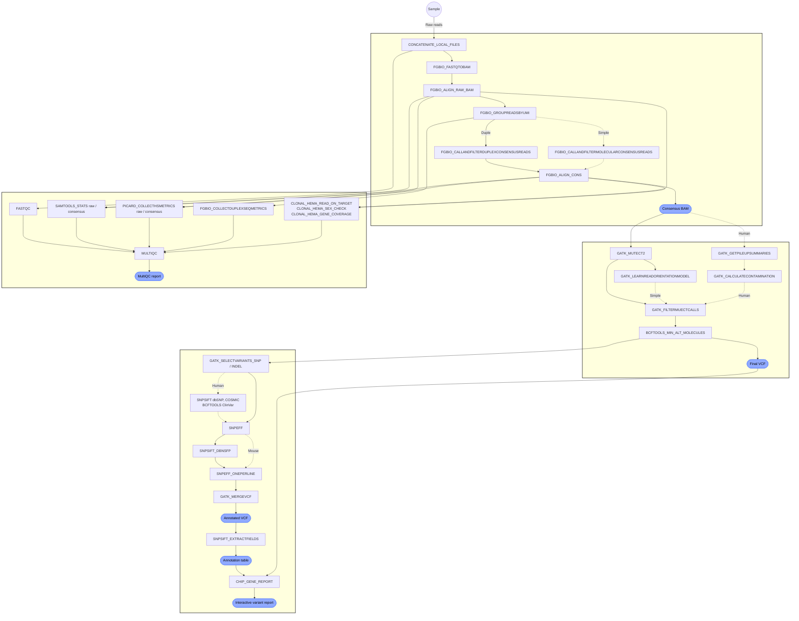

# Clonal Hematopoiesis (Clonal Hema) Documentation

## Clonal Hema Pipeline (`--workflow clonal_hema`)

Tumor-only somatic variant calling for a targeted clonal hematopoiesis gene panel sequenced with UMI (unique molecular identifier) adapters, for human (GRCh38) and mouse (GRCm39). Every sample is analysed on its own; there is no matched normal. Germline variants and recurrent artifacts are removed with a population germline resource and a panel of normals (PoN).

    •	Step 1: Concatenate FASTQ files across lanes per sample
    •	Step 2: FastQC on the raw reads
    •	Step 3: Extract UMIs into an unaligned BAM (fgbio FastqToBam)
    •	Step 4: Align raw reads (bwa-mem2, fgbio ZipperBams)
    •	Step 5: Group reads by UMI (fgbio GroupReadsByUmi)
    •	Step 6: Consensus reads: Duplex (default, fgbio CallDuplexConsensusReads + FilterConsensusReads) or Simplex (fgbio CallMolecularConsensusReads + FilterConsensusReads)
    •	Step 7: Re-align consensus reads (bwa-mem2)
    •	Step 8: Variant calling (GATK Mutect2, tumor-only)
    •	Step 9: Read orientation model (GATK LearnReadOrientationModel; applied in Simplex mode only, see note)
    •	Step 10: Sample contamination (GATK GetPileupSummaries, CalculateContamination; human only)
    •	Step 11: Variant filtration (GATK FilterMutectCalls)
    •	Step 12: Minimum alt molecules filter (bcftools)
    •	Step 13: Annotation (human: dbSNP, COSMIC, ClinVar, dbNSFP; both species: SnpEff), one effect per line, annotation table
    •	Step 14: QC: samtools stats and Picard CollectHsMetrics on raw and consensus BAMs, fgbio CollectDuplexSeqMetrics, per-read on-target rate, sex check, per-gene coverage
    •	Step 15: Interactive variant report and MultiQC report



## Consensus modes: Duplex and Simplex

* **Duplex** (default, `--duplex_seq true`, `--call_min_reads "2 1 1"`): a consensus base needs at least 2 reads in total and at least 1 read from each strand of the original molecule. UMIs are grouped with the `Paired` strategy.
* **Simplex** (`--duplex_seq false`, `--call_min_reads 1`): single-strand consensus; a molecule read once (a singleton) is kept. UMIs are grouped with the `Adjacency` strategy.

**NOTE:** In Duplex mode the read orientation model is computed but not passed to FilterMutectCalls. Duplex consensus reads all come out in one orientation (F1R2), so the model cannot separate orientation artifacts from real variants.

## Minimum alt molecules

Mutect2 has no minimum alt read count, so a single high-quality consensus read can pass. After FilterMutectCalls, a call whose alt allelic depth (FORMAT AD; one consensus read = one molecule) is below `--min_alt_molecules` (default 2) gets the FILTER value `min_alt_molecules`. The record is kept in the VCF. `--min_alt_molecules 1` keeps FilterMutectCalls PASS calls unchanged.

## Species defaults

|  | Human (`--gen_org human`) | Mouse (`--gen_org mouse`) |
| --- | --- | --- |
| Reference | GRCh38 (GATK bundle) | GRCm39 (Ensembl) |
| Germline resource (`--germline_resource_vcf`) | gnomAD af-only (hg38) | Empty placeholder (0 sites). Supply a strain-matched resource for non-B6 mice. |
| Panel of normals (`--pon_ref`) | 1000 Genomes PoN (hg38) | Empty placeholder (0 sites). A PoN built from normal samples of the same assay can be supplied. |
| Contamination (`--contam_ref`) | ExAC common sites (`small_exac_common_3.hg38.vcf.gz`) | Not run |
| Annotation | dbSNP 151, COSMIC v95, ClinVar 20261004, dbNSFP 4.2a, SnpEff (hg38) | SnpEff (GRCm39.105) only |

## Parameters for Clonal Hema Pipeline

* `--pubdir`
	* Default: `/<PATH>`
	* Comment: The directory that the saved outputs will be stored.
* `--project_name`
	* Default: `null`
	* Comment: Optional. Prefix of the report file names: `<NAME>.clonalHema_variant_report.html` and `<NAME>.clonalHema_multiqc_report.html`.
* `--cacheDir`
	* Default: `/projects/omics_share/meta/containers`
	* Comment: This is directory that contains cached Singularity containers. JAX users should not change this parameter.
* `-w`
	* Default: `/<PATH>`
	* Comment: The directory that all intermediary files and nextflow processes utilize. This directory can become quite large. This should be a location on /flashscratch or other directory with ample storage.
* `--csv_input`
	* Default: `null`
	* Comment: Required. CSV sample sheet with the header `sampleID,fastq_1,fastq_2`. Optional columns: `sex,lane,replicate,ind`. Every row is an independent tumor-only sample; there are no patient or tumor/normal columns. See the example below.
* `--gen_org`
	* Default: `human`
	* Comment: Options: `human`, `mouse`. Selects the reference, resources and annotation listed in the species table above.
* `--genome_build`
	* Default: `GRCh38` (human), `GRCm39` (mouse)
	* Comment: Set from `--gen_org`.
* `--read_type`
	* Default: `PE`
	* Comment: Only paired-end data is accepted.
* `--target_gatk`
	* Default: `null`
	* Comment: Required. BED file of the panel target regions, used as `-L` in Mutect2. NOTE: This file MUST reflect the capture panel used to generate your data.
* `--target_picard`
	* Default: `null`
	* Comment: Required. Picard interval list of the panel targets, used by Picard CollectHsMetrics, the per-read on-target rate and per-gene coverage.
* `--bait_picard`
	* Default: `null`
	* Comment: Required. Picard interval list of the capture baits, used by Picard CollectHsMetrics.
* `--read_on_target_padding`
	* Default: `100,500`
	* Comment: Comma-separated bp values. The per-read on-target rate is also reported with the `--target_picard` intervals widened by each value on both sides.
* `--gene_coverage_thresholds`
	* Default: `100,500,1000`
	* Comment: Depth thresholds reported in the per-gene coverage table (% of target bases at or above each depth).
* `--coverage_cap`
	* Default: `20000`
	* Comment: Coverage cap passed to Picard CollectHsMetrics. The Picard default (200) truncates median and per-depth columns at panel depths.
* `--umi_read_structure`
	* Default: `"5M2S+T 5M2S+T"`
	* Comment: fgbio read structure for both mates: 5 bp UMI, 2 bp skipped, then template.
* `--duplex_seq`
	* Default: `true`
	* Comment: `true` = Duplex consensus, `false` = Simplex consensus. See "Consensus modes" above.
* `--groupreadsbyumi_edits`
	* Default: `1`
	* Comment: Number of mismatches allowed between UMIs in fgbio GroupReadsByUmi.
* `--call_min_reads`
	* Default: `"2 1 1"`
	* Comment: Minimum reads per consensus base. Duplex: three values (total, strand A, strand B). Simplex: one value (e.g. `1` keeps singletons).
* `--call_min_baseq`
	* Default: `30`
	* Comment: Minimum base quality of raw reads used in consensus calling.
* `--filter_max_base_error_rate`
	* Default: `0.1`
	* Comment: fgbio FilterConsensusReads maximum base error rate (fgbio default).
* `--ref_fa`
	* Default: human `/projects/omics_share/human/GRCh38/genome/sequence/gatk/Homo_sapiens_assembly38.fasta`; mouse `/projects/omics_share/mouse/GRCm39/genome/sequence/ensembl/GRCm39.p0/Mus_musculus.GRCm39.dna.primary_assembly.fa`
	* Comment: Reference fasta, set from `--gen_org`. JAX users should not change this parameter.
* `--ref_fa_bwamem2_indices`
	* Default: human `/projects/omics_share/human/GRCh38/genome/indices/gatk/bwa2/Homo_sapiens_assembly38.fasta`; mouse `/projects/omics_share/mouse/GRCm39/genome/indices/ensembl/v105/bwa2/Mus_musculus.GRCm39.dna.primary_assembly.fa`
	* Comment: bwa-mem2 index used for raw and consensus alignment. JAX users should not change this parameter.
* `--germline_resource_vcf`
	* Default: human `/projects/omics_share/human/GRCh38/genome/annotation/snps_indels/af-only-gnomad.hg38.vcf.gz`; mouse `assets/clonal_hema/empty_germline_resource_mm39.vcf.gz` (0 sites)
	* Comment: Population allele-frequency VCF for Mutect2 `--germline-resource`.
* `--pon_ref`
	* Default: human `/projects/omics_share/human/GRCh38/genome/annotation/snps_indels/1000g_pon.hg38.vcf.gz`; mouse `assets/clonal_hema/empty_pon.vcf.gz` (0 sites)
	* Comment: Panel-of-normals VCF for Mutect2 `--panel-of-normals`.
* `--genotype_pon`
	* Default: `true` (human), `false` (mouse)
	* Comment: Whether Mutect2 emits (still filtered) calls at PoN sites.
* `--genotype_germline`
	* Default: `true`
	* Comment: Whether Mutect2 emits (still filtered) calls at germline-resource sites.
* `--contam_ref`
	* Default: human `/projects/omics_share/human/GRCh38/genome/annotation/snps_indels/small_exac_common_3.hg38.vcf.gz`; mouse `null` (contamination not run)
	* Comment: Common biallelic SNPs with population AF for GATK GetPileupSummaries and CalculateContamination.
* `--f_score_beta`
	* Default: `2.0`
	* Comment: FilterMutectCalls `--f-score-beta` (relative weight of sensitivity vs precision when FilterMutectCalls sets its threshold).
* `--min_alt_molecules`
	* Default: `2`
	* Comment: Whole number >= 1. See "Minimum alt molecules" above.
* `--dbSNP`, `--cosmic`, `--clinvar`, `--dbNSFP`
	* Default: human `dbsnp_151.vcf.gz`, `COSMICv95_Coding_Noncoding.gatk_formatted.vcf.gz`, `clinvar_20261004.GRCh38.chr.vcf.gz`, `dbNSFP4.2a.gatk_formatted.nochr.txt.gz` (omics_share GRCh38); mouse `null`
	* Comment: Annotation resources. dbSNP and COSMIC add IDs, ClinVar adds CLNSIG, CLNREVSTAT, CLNDN and ALLELEID, dbNSFP adds in-silico scores. Skipped when `null`.
* `--gen_ver`, `--snpEff_config`
	* Default: human `hg38`, `/projects/omics_share/human/GRCh38/genome/indices/snpEff_5_1/snpEff.config`; mouse `GRCm39.105`, `/projects/omics_share/mouse/GRCm39/genome/indices/snpEff_5_1d/snpEff.config`
	* Comment: SnpEff database and configuration. JAX users should not change this parameter.

# Pipeline Default Outputs

**NOTE:** `<ID>` is the `sampleID` from the sample sheet; `<NAME>` is `--project_name`.

| Naming Convention | Description |
| --- | --- |
| `gene_report/<NAME>.clonalHema_variant_report.html` | Interactive variant report: PASS and filtered calls per sample, annotation, per-gene coverage, QC |
| `multiqc/<NAME>.clonalHema_multiqc_report.html` | MultiQC report: FastQC, samtools, Picard HsMetrics, duplex metrics, on-target rate, gene coverage |
| `clonal_hema_report_*.html` | Nextflow run report |
| `trace/` | Nextflow trace of processes |
| `coverage/gene_coverage_all_samples.tsv` | Per-gene coverage for all samples, raw and consensus |
| `coverage/on_target_all_samples.tsv` | Per-read on-target counts and rates (targets and padded targets, raw and consensus), sex check |
| `<ID>/<ID>.consensus.bam` (+ `.bai`) | Aligned consensus BAM |
| `<ID>/<ID>.mutect2_somatic.final.vcf.gz` (+ `.tbi`) | Final VCF: FilterMutectCalls and min_alt_molecules FILTER values |
| `<ID>/<ID>.selected_SNP.vcf.gz`, `<ID>/<ID>.selected_INDEL.vcf.gz` | Filtered calls split into SNPs and INDELs (input to annotation) |
| `<ID>/<ID>.mutect2_somatic.annotated_final.vcf.gz` (+ `.tbi`) | Annotated VCF, one SnpEff effect per line |
| `<ID>/<ID>.annotation_table.txt.gz` | Annotation table extracted from the annotated VCF (SnpSift extractFields) |
| `<ID>/stats/<ID>.CoverageMetrics.txt`, `<ID>/raw/<ID>.raw.CoverageMetrics.txt` | Picard CollectHsMetrics, consensus and raw BAM |
| `<ID>/stats/<ID>.per_target_coverage.txt`, `<ID>/raw/<ID>.raw.per_target_coverage.txt` | Picard per-target coverage, consensus and raw BAM |
| `<ID>/stats/<ID>.stats`, `<ID>/raw/<ID>.stats` | samtools stats, consensus and raw BAM |
| `<ID>/stats/<ID>.flagstat`, `<ID>/stats/<ID>.idxstats` (and in `raw/`) | samtools flagstat and idxstats |
| `<ID>/stats/<ID>.duplex_seq_metrics.*` | fgbio CollectDuplexSeqMetrics (family sizes, duplex yield, UMI counts, QC PDF) |
| `<ID>/stats/<ID>.family-sizes.txt` | fgbio GroupReadsByUmi family sizes |
| `<ID>/stats/<ID>.gene_coverage.tsv` | Per-gene coverage for the sample |
| `<ID>/stats/<ID>.on_target.tsv` | Per-read on-target counts and rates for the sample |
| `<ID>/stats/<ID>.mutect2_somatic.filtered.vcf.gz.filteringStats.tsv` | FilterMutectCalls filtering statistics |
| `<ID>/stats/<ID>.filter_breakdown.txt` | Counts of calls per FILTER value |
| `<ID>/stats/<ID>.bcftools_stats.txt` | bcftools stats on the final VCF |
| `<ID>/stats/*_fastqc.html` (+ `.zip`) | FastQC reports |

## CSV Input Sample Sheet

The sample sheet is required (`--csv_input`). Required columns: `sampleID,fastq_1,fastq_2`. Optional columns: `sex,lane,replicate,ind`. Rows with the same `sampleID` (for example one row per lane) are concatenated before analysis.

### Basic example

```
sampleID,fastq_1,fastq_2
SAMPLE_A,/path/to/SAMPLE_A_L001_R1_001.fastq.gz,/path/to/SAMPLE_A_L001_R2_001.fastq.gz
SAMPLE_A,/path/to/SAMPLE_A_L002_R1_001.fastq.gz,/path/to/SAMPLE_A_L002_R2_001.fastq.gz
SAMPLE_B,/path/to/SAMPLE_B_L001_R1_001.fastq.gz,/path/to/SAMPLE_B_L001_R2_001.fastq.gz
```

### Example run (mouse, Duplex)

```
nextflow run main.nf -profile sumner2 \
  --workflow clonal_hema \
  --gen_org mouse \
  --csv_input samplesheet.csv \
  --target_gatk panel_targets.bed \
  --target_picard panel_targets.interval_list \
  --bait_picard panel_baits.interval_list \
  --project_name MY_PROJECT \
  --pubdir /path/to/results \
  -w /flashscratch/$USER/clonal_hema_work
```
